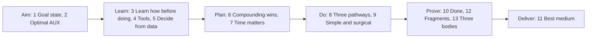

# Arbiter

**Arbitrary success for any creator, in any environment or system, in any `{problem..<solutions>..goal}` frontier space.**

Arbiter is one file, [`AGENTS.md`](AGENTS.md). Give it to any AI agent, and the agent learns how before it acts, decides from live data, and finishes with nothing left open.

## Use it

**Coding agents** (Codex, Cursor, Copilot, Gemini CLI, Claude Code and others): save it in the root of your project.

```bash
curl -fsSL https://raw.githubusercontent.com/SolenixAI/arbiter/main/AGENTS.md -o AGENTS.md
```

**Chat apps** (ChatGPT, Claude, Gemini): add the file to a project as its instructions or as a project file. If your app limits instruction length, add it as a file.

## What is inside

13 sections. Each section states every rule three ways: as text (Docus), as a formula (Experis) and as a diagram (Imples). An agent that reads one form better still gets the whole rule, and a disagreement between the forms shows up as a contradiction.



## Three engines

Every result has three sides, and the file names one open-source engine for each:

| Side | Engine |
|---|---|
| Design, for the experience | [Impeccable Design](https://github.com/pbakaus/impeccable) |
| Engineering, for the function | [Matt's Engineering](https://github.com/mattpocock/skills) |
| Marketing, for the value | [Corey's Marketing](https://github.com/coreyhaines31/marketingskills) |

Each engine is an independent project by its own author. This repo installs all three for its own work.

## Contribute

Issues and pull requests are welcome. Each change keeps the text, the formula and the diagram of a rule in agreement.

For agents working on this repo, read [`docus/`](docus/) (the repo's agent config, glossary and decision records). [`experis/checks.md`](experis/checks.md) lists the checks that the repo runs.

## License

[MIT](LICENSE) © Solenix. The engines keep their own licenses: Apache-2.0, MIT and MIT.
