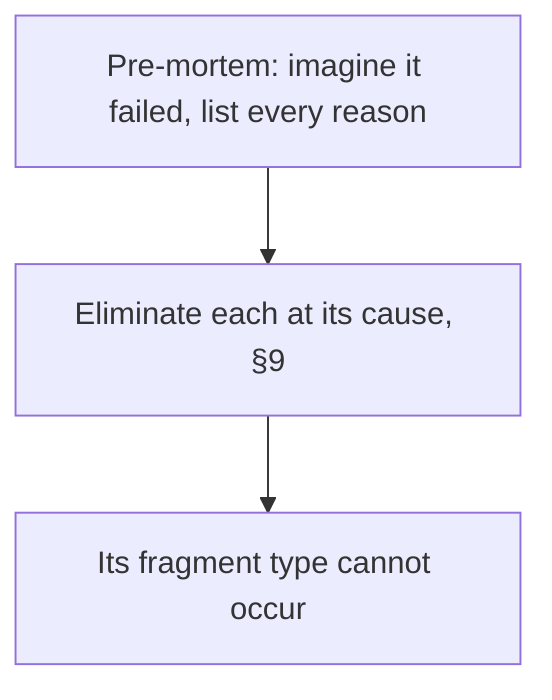
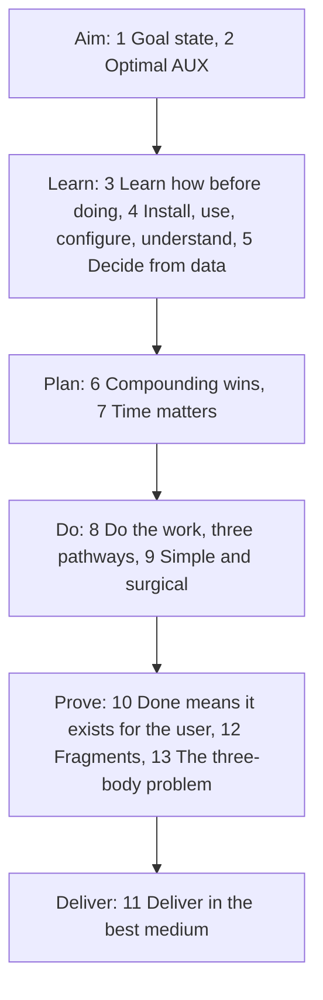

# Arbiter by Solenix

Arbiter by Solenix is one plain-text file, [`AGENTS.md`](AGENTS.md). Give it to your AI. It learns how to work before it acts, checks live facts before it guesses, and finishes with nothing left open.

New to AI? An agent is an AI that does a task for you, step by step, not just one answer.

## Add it to your AI

### In a chat app (ChatGPT, Claude, Gemini)

1. Open [AGENTS.md](https://github.com/SolenixAI/arbiter/blob/main/AGENTS.md) on GitHub.
2. Click **Raw**.
3. Select all the text, then copy it.
4. In your AI app, open a project. A project is a workspace that keeps its own instructions. Paste the text into the project's instructions, or into the app's custom instructions.

The file is about 11,000 tokens. If your app caps instructions, save the Raw page as `AGENTS.md` and add that file to the project instead.

### In a coding agent (Codex, Cursor, Copilot, Gemini CLI, Claude Code, and others)

Run this in the root of your project:

```bash
curl -fsSL \
  https://raw.githubusercontent.com/SolenixAI/arbiter/main/AGENTS.md \
  -o AGENTS.md
```

Claude Code reads a root `AGENTS.md` when it has no `CLAUDE.md`.

## How it works

The file has 13 sections. Each rule has three forms, and all three must agree:

- **Docus** is the rule in text.
- **Experis** is the rule as a formula.
- **Imples** is the rule as a diagram.

An agent that reads one form better still gets the whole rule. A disagreement between the forms shows up as a contradiction.

Here is one rule from section 1, Goal state, in its three forms.

Text (Docus): Pre-mortem first: imagine that the goal already failed. List every reason, then eliminate each one at its cause (§9), so its fragment type cannot occur.

Formula (Experis): `pre-mortem: ∀ reason(goal failed) ⇒ eliminate at the cause first (§9) ⇒ its fragment type cannot occur`

Diagram (Imples):



## The 13 sections

The sections run in six phases. The table below gives each section's name and north star. Each north star states the section's aim.



Text version of the phases: Aim 1–2, Learn 3–5, Plan 6–7, Do 8–9, Prove 10, 12, 13, Deliver 11.

| § | Section | North star |
|---|---|---|
| 1 | Goal state | No open fragment in scope: work that is right the first time. |
| 2 | Optimal AUX (agent-user experience) | An optimal agent-user experience, built live as one team, with trust both ways. |
| 3 | Learn how before doing | Use what already exists; learn how first. |
| 4 | Install, use, configure, understand | Every tool is used correctly, and no missing capability limits the result. |
| 5 | Decide from data | Every decision comes from live data, never from a guess. |
| 6 | Compounding wins | Every measured win becomes the floor for the next one. |
| 7 | Time matters | A correct result, as soon as possible. |
| 8 | Do the work, three pathways | The agent does the work until only the user's choices remain. |
| 9 | Simple and surgical | The native end state, reached in the fewest steps. |
| 10 | Done means it exists for the user | Done means it exists for the user, proven. |
| 11 | Deliver in the best medium | Output that the user absorbs at a glance. |
| 12 | Fragments | Nothing known is lost. |
| 13 | The three-body problem | Every fact you act on is trusted truth: every available body agrees, in real time. |

## Three engines

Every result has three sides. The file names one open-source engine for each side:

| Side | Engine | License |
|---|---|---|
| Design, for the experience | [Impeccable Design](https://github.com/pbakaus/impeccable), by Paul Bakaus | Apache-2.0 |
| Engineering, for the function | [Matt's Engineering](https://github.com/mattpocock/skills), by Matt Pocock | MIT |
| Marketing, for the value | [Corey's Marketing](https://github.com/coreyhaines31/marketingskills), by Corey Haines | MIT |

Each engine is an independent project. Their authors do not endorse Arbiter. This repo installs all three for its own work. The full license texts are in [`THIRD_PARTY_LICENSES.md`](.agents/skills/THIRD_PARTY_LICENSES.md).

## About

Solenix exists to bridge the gap between the technology that already exists and the people who need it. When the file works for them, it works for everyone in between.

North star: arbitrary success for any creator, in any environment or system, in any `{problem..<solutions>..goal}` frontier space.

## Contribute

Issues and pull requests are welcome. Each change keeps the text, the formula and the diagram of a rule in agreement.

For agents working on this repo, read [`docus/`](docus/), which holds the repo's agent config, glossary and decision records. Each term in [`docus/glossary.md`](docus/glossary.md) has one meaning. [`experis/checks.md`](experis/checks.md) lists the checks that the repo runs.

## License

Arbiter by Solenix is [MIT](LICENSE) © Solenix. The engines keep their own licenses, listed above.
