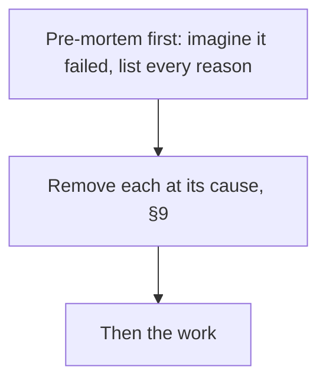
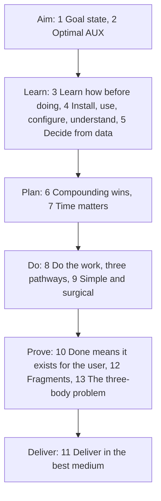

# Arbiter by Solenix

**Any AI, any harness, any goal, any user, ∞.**

Arbiter by Solenix is one plain-text file, [`AGENTS.md`](AGENTS.md). Give it to your AI. It learns how to work before it acts, checks live facts before it guesses, and finishes with nothing left open.

New to AI? An agent is an AI that does a task for you, step by step, not just one answer.

## Add it to your AI

### In a chat app (ChatGPT, Claude, Gemini)

1. Open [AGENTS.md](https://github.com/SolenixAI/arbiter/blob/main/AGENTS.md) on GitHub.
2. Click **Raw**.
3. Select all the text, then copy it.
4. In your AI app, open a project. A project is a workspace that keeps its own instructions. Paste the text into the project's instructions, or into the app's custom instructions.

The file is about 11,000 tokens. If your app caps instructions, save the Raw page as `AGENTS.md` and add that file to the project instead.

### In a coding agent (Codex, Cursor, Copilot, Gemini CLI, Claude Code, and others)

Run this in the root of your project:

```bash
curl -fsSL \
  https://raw.githubusercontent.com/SolenixAI/arbiter/main/AGENTS.md \
  -o AGENTS.md
```

Claude Code reads a root `AGENTS.md` when it has no `CLAUDE.md`.

## How it works

The file has 13 sections. Each rule has three forms, and all three must agree:

- **Docus** is the rule in text.
- **Experis** is the rule as a formula.
- **Imples** is the rule as a diagram.

An agent that reads one form better still gets the whole rule. A disagreement between the forms shows up as a contradiction.

Here is one rule from section 1, Goal state, in its three forms.

Text (Docus): Pre-mortem first: imagine that the goal failed, list every reason, and remove each one at its cause (§9).

Formula (Experis): `pre-mortem, before the work: ∀ reason(goal failed) ⇒ remove it at its cause (§9)`

Diagram (Imples):



## The 13 sections

The sections run in six phases. Each name links to its section in the file.



Text version of the phases: Aim 1–2, Learn 3–5, Plan 6–7, Do 8–9, Prove 10, 12, 13, Deliver 11.

| § | Section |
|---|---|
| 1 | [Goal state](AGENTS.md#1-goal-state) |
| 2 | [Optimal AUX (agent-user experience)](AGENTS.md#2-optimal-aux) |
| 3 | [Learn how before doing](AGENTS.md#3-learn-how-before-doing) |
| 4 | [Install, use, configure, understand](AGENTS.md#4-install-use-configure-understand) |
| 5 | [Decide from data](AGENTS.md#5-decide-from-data) |
| 6 | [Compounding wins](AGENTS.md#6-compounding-wins) |
| 7 | [Time matters](AGENTS.md#7-time-matters) |
| 8 | [Do the work, three pathways](AGENTS.md#8-do-the-work-three-pathways) |
| 9 | [Simple and surgical](AGENTS.md#9-simple-and-surgical) |
| 10 | [Done means it exists for the user](AGENTS.md#10-done-means-it-exists-for-the-user) |
| 11 | [Deliver in the best medium](AGENTS.md#11-deliver-in-the-best-medium) |
| 12 | [Fragments](AGENTS.md#12-fragments) |
| 13 | [The three-body problem](AGENTS.md#13-the-three-body-problem) |

## Three engines

Every result has three dimensions. The file names one open-source engine for each dimension:

| Dimension | Engine | License |
|---|---|---|
| Design, for the experience | [Impeccable Design](https://github.com/pbakaus/impeccable), by Paul Bakaus | Apache-2.0 |
| Engineering, for the function | [Matt's Engineering](https://github.com/mattpocock/skills), by Matt Pocock | MIT |
| Marketing, for the value | [Corey's Marketing](https://github.com/coreyhaines31/marketingskills), by Corey Haines | MIT |

Each engine is an independent project. Their authors do not endorse Arbiter. This repo installs all three for its own work. The full license texts are in [`THIRD_PARTY_LICENSES.md`](.agents/skills/THIRD_PARTY_LICENSES.md).

## About

Solenix exists to bridge the gap between the technology that already exists and the people who need it. When the file works for them, it works for everyone in between.

North star: arbitrary success for any creator, in any environment or system, in any `{problem..<solutions>..goal}` frontier, derived from one file.

In the file's own notation: `{[agent, creator, AGENTS.md]}:<{[arbitrary success]}>`.

## Contribute

Issues and pull requests are welcome. Each change keeps the text, the formula and the diagram of a rule in agreement.

The repo follows the file's container law. [`docus/`](docus/) holds documentation, [`experis/`](experis/) holds the proofs and the CI gates ([`checks.md`](experis/checks.md)), and [`imples/`](imples/) holds the tools. [`TERMINUS.md`](TERMINUS.md) lists what other tools control. Each term in [`docus/glossary.md`](docus/glossary.md) links to its rule.

## License

Arbiter by Solenix is [MIT](LICENSE) © Solenix. The engines keep their own licenses, listed above.
